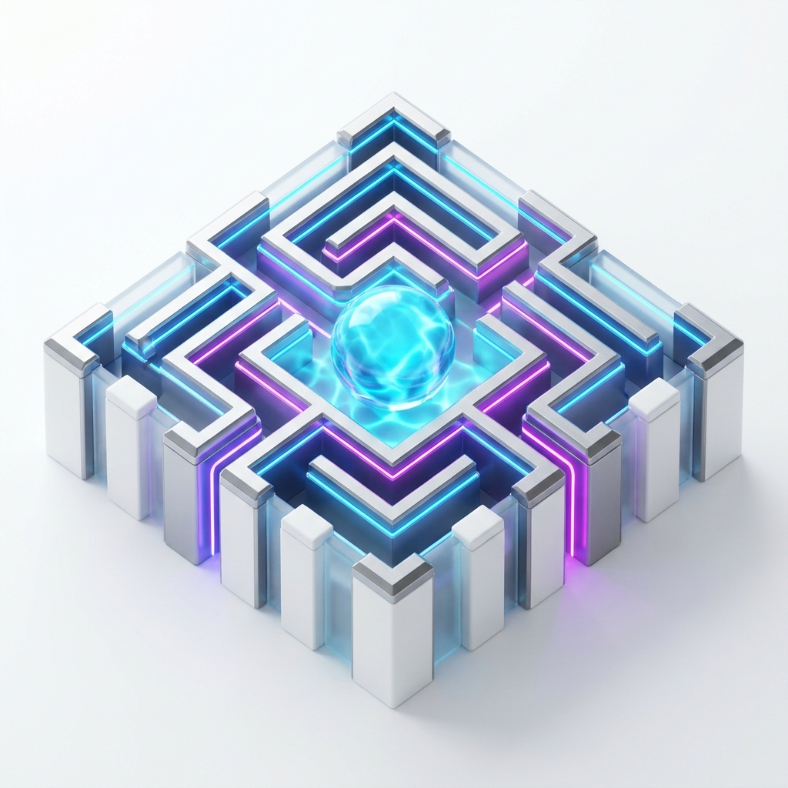
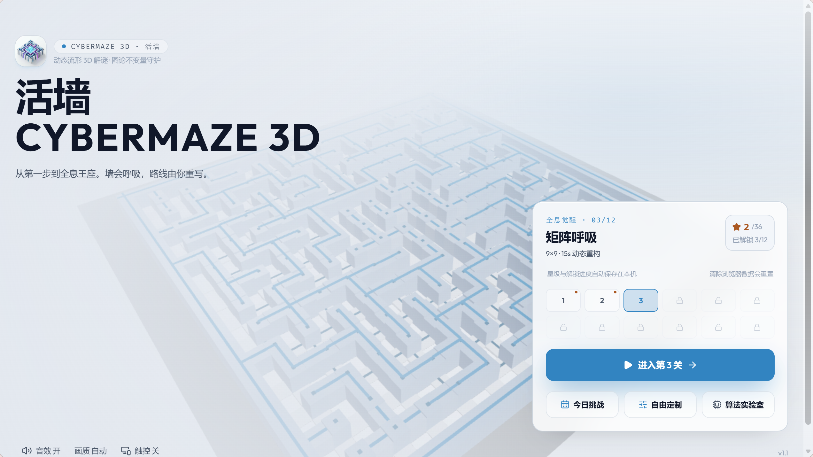
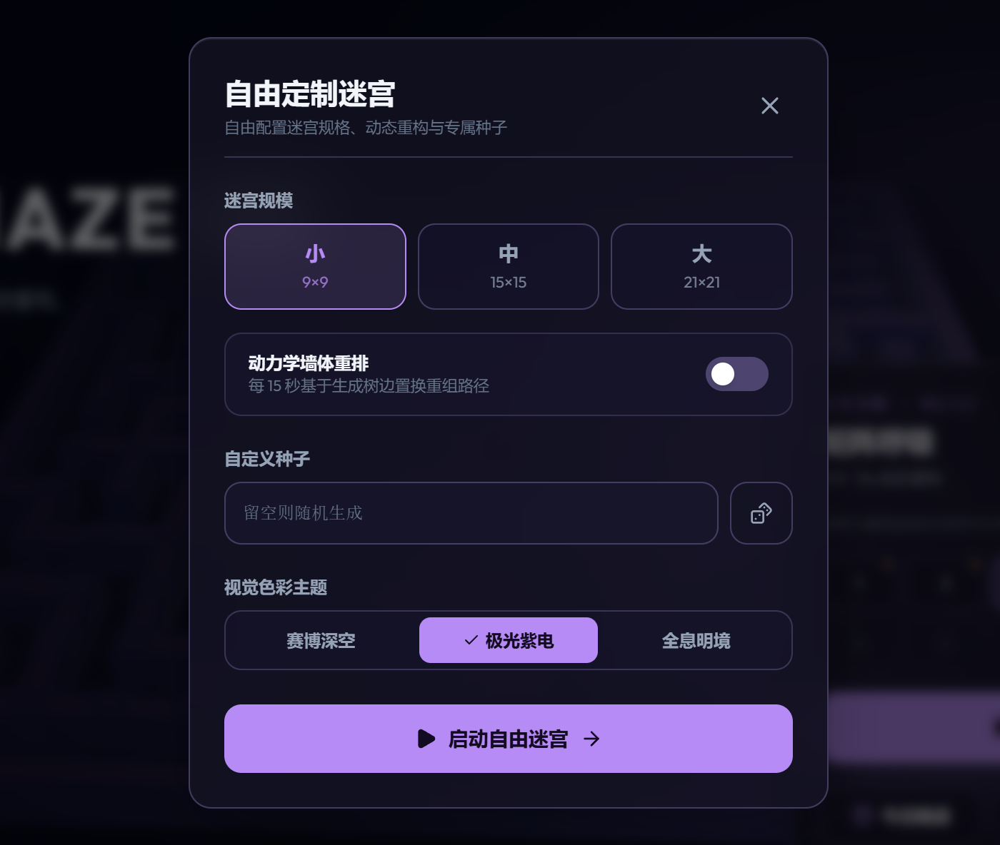
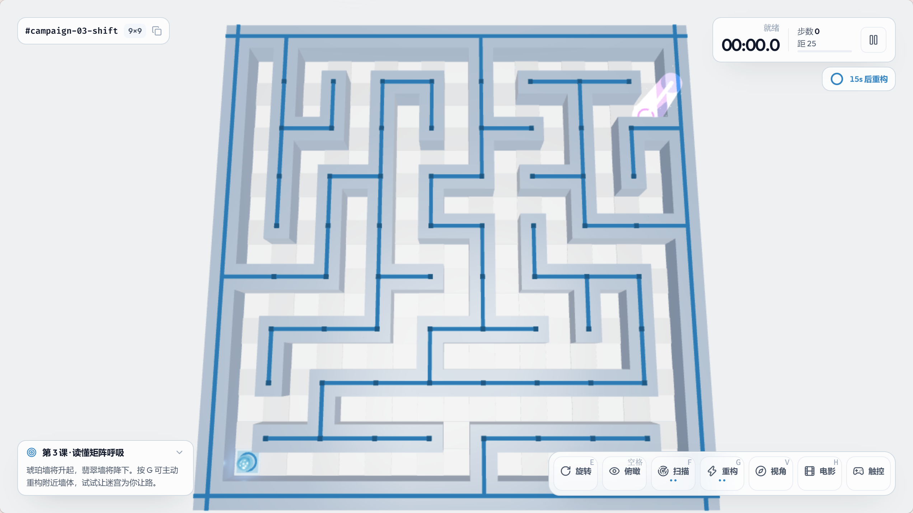
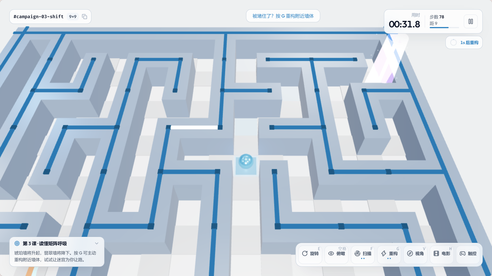
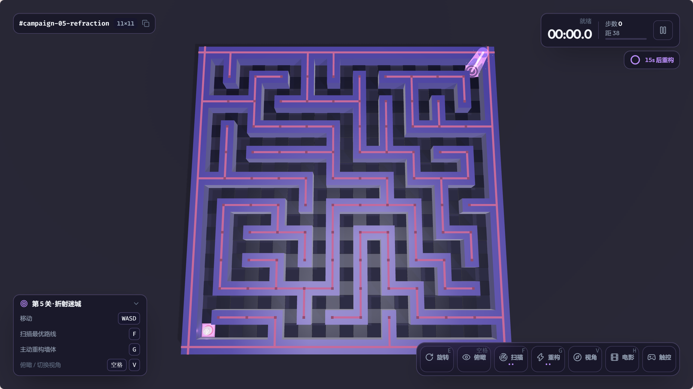
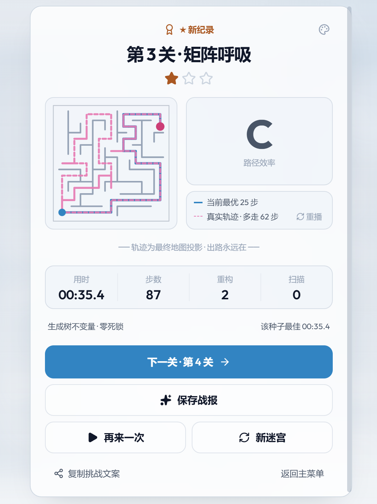
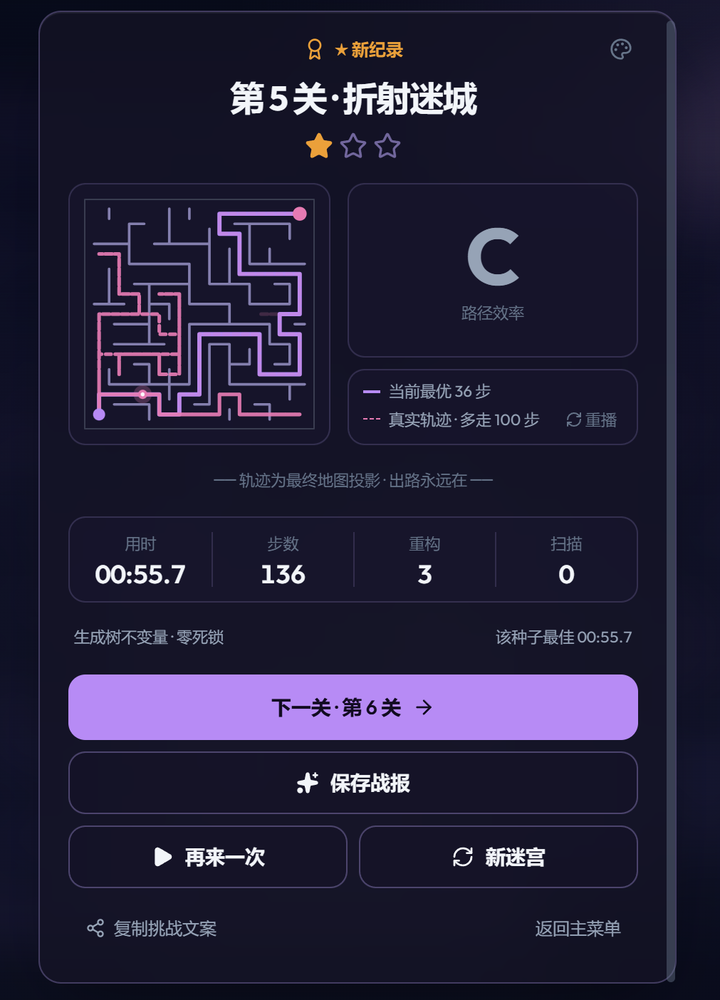
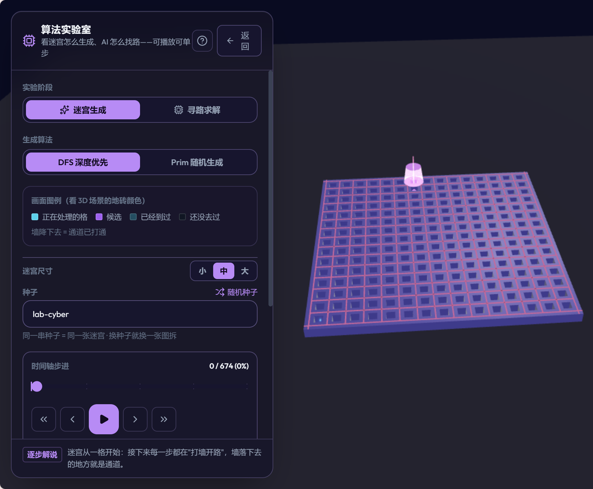
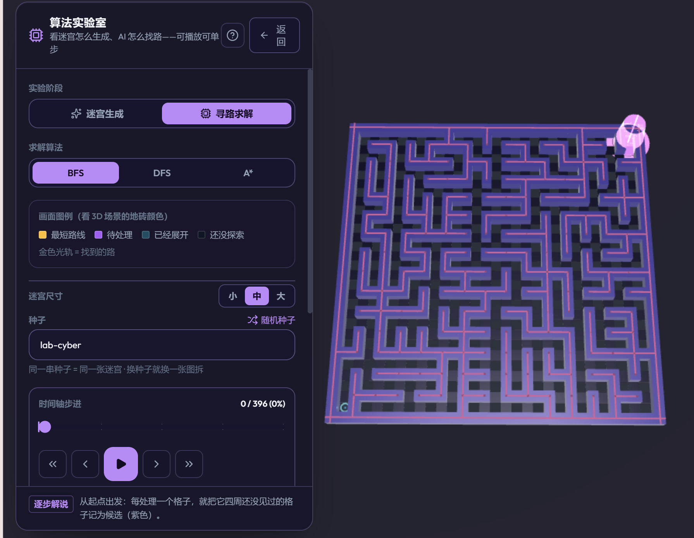

<!-- CyberMaze 3D · Living Walls — official open-source project README -->
<div align="center">

  <p><a href="README.md">简体中文</a> · <b>English</b></p>

  

  # CyberMaze 3D · Living Walls
  ### A reshuffling 3D puzzle · guarded by graph invariants · a living cyber maze
  **From your first step to the holographic throne. Walls breathe; you rewrite the route.**

  <p>
    <!-- Author -->
    <a href="https://yibeigen.pages.dev/"></a>
    <!-- Play online -->
    <a href="https://cyber-maze-3d.app.workbuddy.host/?sharecode=OFR2R7A3MK"></a>
    <!-- Unit tests -->
    
    <!-- Tech stack -->
    
    
    
    <!-- License -->
    <a href="LICENSE"></a>
  </p>

  <p><b>“Break past the static boundaries of classic mazes and dive into kinetic topology plus a 3D light show.”</b><br>
  No install, no sign-up — open your browser and set off. The game UI supports Chinese and English, with Chinese as the default.</p>

  | 🎮 Play instantly | 💻 Source code | 💬 Community |
  | :---: | :---: | :---: |
  | [**Play online now (no install)**](https://cyber-maze-3d.app.workbuddy.host/?sharecode=OFR2R7A3MK) | [**GitHub / cyber-maze-3d**](https://github.com/yibeigen/cyber-maze-3d) | Follow the WeChat account **艺杯羹** and reply **迷宫** |

</div>

<br>

---

## 📸 Gallery (visuals & core systems)

No walls of text — the screenshots show what CyberMaze 3D · Living Walls feels like:

### 1. Immersive holographic home · full customization
A modern translucent holographic glass UI over a 3D maze that is literally breathing behind it. Switch themes right on the home screen, or open **Custom Run** to pick the maze size (S/M/L), toggle kinetic reshaping, and set your own seed.

| Home screen (bright holographic light theme) | Custom run dialog (seed & size) |
| :---: | :---: |
|  |  |

---

### 2. In-game · kinetic wall animation (the maze that reshapes)
Step inside and mechanical walls rise and fall on a timer. Built on the **fundamental-cycle edge swap of a spanning tree**, the maze is mathematically guaranteed to stay solvable no matter how the walls rearrange — **no deadlocks, ever**.

| Holographic light theme | Kinetic walls (rising walls & glowing trail) |
| :---: | :---: |
|  |  |

---

### 3. Multiple visual themes · cyber deep space & aurora violet
Beyond the crisp, airy **Holographic Light** default, the game ships with dark esports-grade sci-fi themes. Neon light trails and deep-space backdrops deliver a strong cyberpunk immersion.

<div align="center">
  
  <p><sub>▲ Aurora violet: amethyst pillars, neon energy guides, and midnight lighting</sub></p>
</div>

---

### 4. Run report · 2D topology projection & real-path replay
After you escape, you get time, move count, and a star rating — plus a 2D topology projection that compares your **actual route** with the **A\* optimal path**. Replay your run frame by frame or save a high-resolution share card.

| Holographic light · result panel | Aurora violet · neon result panel |
| :---: | :---: |
|  |  |

---

### 5. Algorithm Lab · 3D graph theory & pathfinding visualization
A built-in lab that steps through maze generation (wall carving) and AI pathfinding (wavefront expansion) — frame by frame or auto-play. A serious teaching aid for computer graphics and algorithm visualization.

| Maze generation (DFS / Prim) | Pathfinding (BFS / DFS / A\*) |
| :---: | :---: |
|  |  |

---

## 🎮 Controls

| Input | Action |
| :---: | :--- |
| **W / A / S / D** or **arrow keys** | Move the holographic mech forward, back, left, and right through the corridors |
| **Space** | Toggle / hold for a high overhead view of the whole route |
| **G** | Trigger one kinetic edge swap and rebuild nearby walls |
| **F** | Fire a holographic scan pulse to reveal the optimal route to the exit |
| **Q / E** | Rotate the 3D camera smoothly in 90° steps |
| **V / H** | Toggle follow camera angle / toggle cinematic clean mode |
| **Esc / P** | Open the pause menu (quality, sound, visual theme) |
| **Mobile** | Swipe one cell at a time; the floating dock offers one-tap camera rotation, overhead view, and skills |

---

## ⚡ Run locally

A clean, modern frontend stack (Vite 6 + React 18 + Three.js + TypeScript) — ready out of the box:

```bash
# 1. Clone the repository
git clone https://github.com/yibeigen/cyber-maze-3d.git
cd cyber-maze-3d

# 2. Install dependencies
npm install

# 3. Start the dev server
npm run dev
```

Then open `http://localhost:5173/` in your browser.
Run the full unit test suite with `npm run test`.

---

## 👨‍💻 About the author

**yibeigen (艺杯羹)**
*Independent developer · creator of productivity tools and knowledge-distillation systems*

- **Homepage**: [yibeigen.pages.dev](https://yibeigen.pages.dev/)
- **CSDN blog**: [Author's CSDN profile](https://blog.csdn.net/qq_46987323?spm=1000.2115.3001.5343)
- **Weibo**: [@艺杯羹](https://www.weibo.com/u/7583841270)
- **Contact**: WeChat `peace-83` | QQ `3057454077` (*technical exchange, bug reports, feature requests, and business inquiries are welcome*)

### 🛠️ More open-source tools by the author
- [**BlogDistiller**](https://doc.305758.xyz/) ([GitHub](https://github.com/yibeigen/wechat-article-exporter)): batch-download and distill articles from 9 platforms including WeChat Official Accounts, Zhihu, Weibo, and CSDN, with noise removal and multi-format export.
  - *How to get it*: follow the WeChat account **艺杯羹** and reply **文章** to receive an activation code and desktop client for free.
- [**PipTeleprompter**](https://pip.305758.xyz/) ([GitHub](https://github.com/yibeigen/PipTeleprompter)): a high-performance, pure-frontend teleprompter with AI voice-follow scrolling and picture-in-picture desktop overlay.
  - *How to get it*: **no reply needed — just open the site and use it for free!**

<br>

<div align="center">
  <table align="center" style="border: none; margin: 12px auto;">
    <tr>
      <td align="center" style="border: none; padding: 0 20px;">
        
        <br />
        <sub><b>WeChat Official Account: 艺杯羹</b></sub>
        <br />
        <sub>Scan to follow · reply **迷宫** for the community group · reply **文章** for BlogDistiller</sub>
      </td>
      <td align="center" style="border: none; padding: 0 20px;">
        
        <br />
        <sub><b>Support (Reward)</b></sub>
        <br />
        <sub>Open source takes time — if you enjoy the game, buy the author a coffee ☕</sub>
      </td>
    </tr>
  </table>
</div>

---

## 📄 License

Released under the [MIT License](LICENSE). Learning, sharing, and derivative works are welcome. For commercial use or enterprise integration, please keep the original author's attribution.
